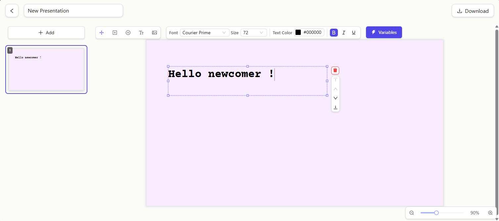
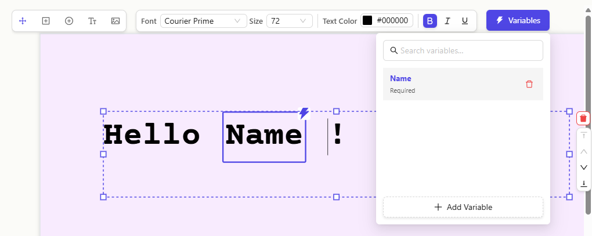
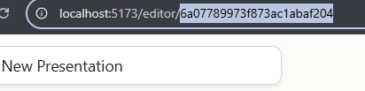
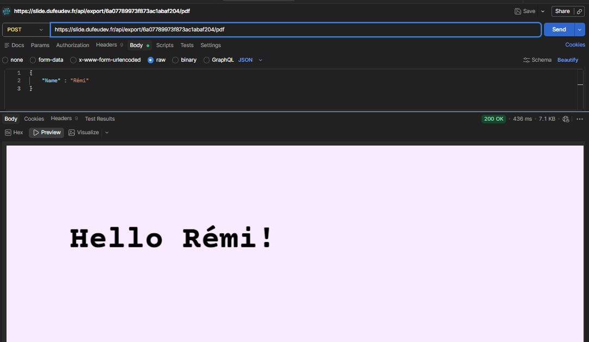
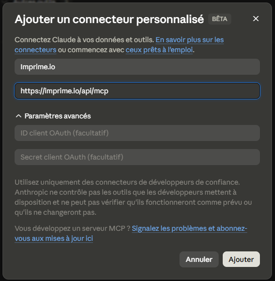

# What is this project

> Demo: [https://imprime.io/](https://imprime.io/)

Imprime is a tool that speeds up document generation. It allows you to design templates in a visual editor by placing placeholders within them, and then generate the final documents either via the download button or via an API.

Designed primarily for developers, Imprime integrates as a dedicated component within your architecture, to which you can fully delegate the templating and document generation processes.

# Why Imprime

This project arose from a developer’s frustration: generating documents programmatically remains a tedious task, one that is poorly supported by existing tools such as DOCX markup or HTML templates.

# Can i use Imprime

The Apache 2.0 licence legally gives you the right to do pretty much anything you like with Imprime — including redistributing it commercially. We simply ask, in all friendship, that you do not take Imprime as it is and resell it as your own product or service. The licence allows it, but we would appreciate it if you didn’t.

If Imprime is useful to you, the best way to support the project is to use it, share it, contribute, or simply use the futur official SaaS version.

# Features

## A full-featured document editor
At its core, Imprime is a powerful document editor. It ships with everything you'd expect from a modern editing experience: rich text formatting, shapes, images, groups with auto-layout, copy / paste / duplicate shortcuts, and more — all in an intuitive visual interface.

Each template picks its page format when it is created: A4 portrait, A4 landscape, 16:9, or any custom size.


## Dynamic variables
Turn any document into a reusable template. Drop variables anywhere in your design, then generate finished documents on demand by injecting the data of your choice — perfect for invoices, contracts, reports, and any document you produce more than once.

Number the pages as slide numbers are: switch **Page numbers** on from the page bar, and one text box shows up at the same place on every page — move it, restyle it or reword it on any page, and every page follows. Leave it off the first page, or off any other. Its text, like any text, takes the automatic variables **Page number** and **Page count** — *Page 2 of 5* — counted in the PDF, once repeated pages are copied and conditional ones left out.

Go further with **conditional** blocks (`if`) that only show a section when a boolean is true, and **iteration** blocks (`for`) that repeat their content for each item of a list — lists can be nested to build tables and sub-lists. Whole pages work the same way: a page can be left out on a condition, or generated once per item of a list — one invoice per customer, one sheet per product.


## Built for automation
Imprime is designed from the ground up for developers. Build your template once, then programmatically generate polished, data-driven documents at scale — through a clean REST API or directly from your AI agents via MCP.

### API
To print a template, you only need its ID. The easiest way to grab it is straight from the template's URL.



Then fire a POST request to the endpoint below, with a JSON body matching your template's variables — and get back a ready-to-ship PDF.
```
https://imprime.io/api/export/{{templateId}}/pdf
```

Authenticate the call by passing an API key generated from **Settings → API Keys** in the `x-api-key` header.



Rather than an ID, give the template a **code** — `INVOICE_FR`, in the field next to its title in the editor — and print it by that code. A code is letters, digits, `-` and `_`, unique among your templates:
```
https://imprime.io/api/export/code/{{code}}/pdf
```

### Preview
Before printing, see the document as it will come out: **Preview** in the editor asks for the variable values and shows every page of the PDF — repeated pages copied, conditions applied, page numbers counted — with a button to print it. A preview stays open for 24 hours, to its owner only, and reads the template as it is when opened: edit, then refresh. Through the API, `POST /api/templates/{{templateId}}/previews` with the variable values makes one, shown at `/preview/{{previewId}}`.

### Export and import
**Export** on a template's card saves it as a `.imprime.json` file — pages, variables and images included — and **Import** on the home page turns such a file back into a template, on this instance or another — as many times as you like: when another of your templates already has its code, you are asked for another one. Through the API: `GET /api/templates/{{templateId}}/file` and `POST /api/templates/import`.

### MCP
Imprime exposes an MCP server at `https://imprime.io/api/mcp` (Streamable HTTP transport). Two authentication modes are supported depending on the client:

- **OAuth 2.1 (Bearer token)** — for interactive clients like the Claude web connector. Add a custom connector pointing at `https://imprime.io/api/mcp`; the OAuth flow (discovery, login, consent, token exchange) is handled automatically by Better Auth's MCP plugin.
- **API key** — for headless clients like Claude Code, Claude Desktop, the Imprime SDK, or any script. Pass your key in the `x-api-key` header:

```json
{
  "mcpServers": {
    "imprime": {
      "type": "http",
      "url": "https://imprime.io/api/mcp",
      "headers": { "x-api-key": "<your-api-key>" }
    }
  }
}
```

Both paths land on the same server and expose the same tools — plug Imprime into your AI agents or chat interfaces and let them design templates and generate PDFs on your behalf:

| | Tools |
|---|---|
| Templates | `list_templates`, `get_template`, `create_template`, `update_template` (title, code), `set_page_numbering`, `delete_template` |
| Pages | `add_page`, `update_page` (condition, repeat, page number), `move_page`, `delete_page` |
| Variables | `create_variable`, `update_variable`, `delete_variable` |
| Shapes | `set_page_shapes`, `add_shapes`, `update_shape`, `delete_shapes` |
| Assets | `list_fonts`, `upload_image` |
| Preview | `preview_template` |

Ask *"Create an A4 invoice template with a customer name and a list of lines, then preview it with sample data"* and the agent builds it end to end, and hands you the link to its preview — open it signed in, and print the PDF from there. Every shape it writes is validated, and groups are laid out exactly as the editor would. Reload the editor to see an agent's changes to a template you have open.



## Sign-in and access control
Sign in with an email and a password, or with Google, GitHub or Microsoft. The administrator sets everything up from the app — SMTP server, single sign-on providers, who may sign in and from which domains — and a single `ADMIN_EMAIL` in the environment is all it takes to get started. See [Authentication and access](./doc/authentication.md).

# Roadmap

Imprime is currently under active development. Here are the main planned updates:

## Improve shape
- Add arrow

## Document format
- Add default style (font and bg color)

## Automation
- MCP edition
- test API

---

This roadmap is indicative and will evolve based on user feedback. Please feel free to open an *issue* to suggest features or vote for the ones that interest you most.
